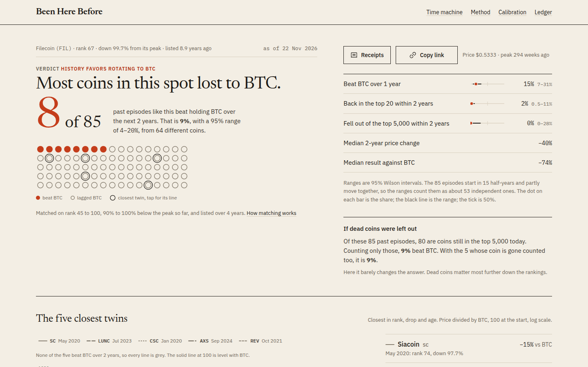
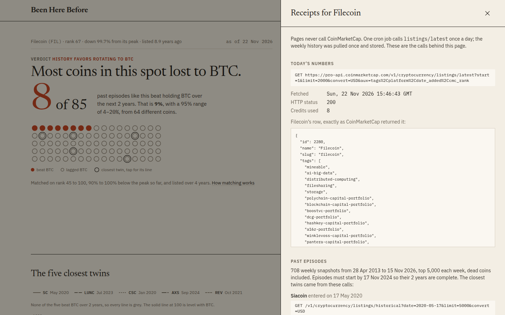

# Been Here Before

Type a coin. See every past coin that stood in the same spot, and how it ended up against BTC.

[](https://github.com/Sarcastic-Soul/been-here-before/actions/workflows/ci.yml)

**Live:** https://been-here-before.vercel.app · **Track:** Data and Visualisation · Built for the Build with CMC API Hackathon, Round 2 (DoraHacks)



## Submission checklist

| Required item                                          | Where                                                                                                              |
| ------------------------------------------------------ | ------------------------------------------------------------------------------------------------------------------ |
| 1. Public GitHub repository                            | This repository                                                                                                    |
| 2. Working demo                                        | https://been-here-before.vercel.app (demo video linked from the BUIDL page)                                        |
| 3. X post with #BuildwithCMC                           | Linked from the BUIDL page                                                                                         |
| 4. CMC API endpoints used, named                       | [CoinMarketCap endpoints used](#coinmarketcap-endpoints-used)                                                      |
| 5. Evidence of a real API call: code and response      | [Evidence of a real API call](#evidence-of-a-real-api-call), and the **Receipts** drawer on every coin page        |
| 6. What the API made possible, where it got in the way | [What the API made possible, and where it got in the way](#what-the-api-made-possible-and-where-it-got-in-the-way) |
| 7. Track                                               | Data and Visualisation                                                                                             |

## What it does

Most crypto charts show one coin. This app asks a different question: _when other coins were where this one is now, what happened next?_

1. You pick a coin, for example Filecoin.
2. The app reads its spot today: rank (after removing stablecoins and wrapped tokens), how far it is below its peak so far, and how long it has been listed on CoinMarketCap.
3. It searches 708 weekly CoinMarketCap snapshots from April 2013 to November 2026, **dead coins included**, for every coin that was once in the same spot.
4. It follows each of those past coins for the next 2 years and counts how many beat simply holding BTC.
5. It says the answer in plain words, with the count, a 95% range and every past episode behind it.

Filecoin today (rank 67, down 99.7% from its peak, listed 8.9 years ago) matches 85 past episodes from 64 different coins. 8 of them beat BTC over 2 years: 9%, with a 95% range of 4–20%. In plain words: **most coins in this spot lost to BTC** (verdict: "History favors rotating to BTC"). Counting only coins that are still alive today would have given 7 of 80; every coin page shows that comparison next to the real count.

It is a base rate, not a forecast and not financial advice.

### On every coin page

- **The answer:** a plain heading, the count, the 95% range, and a dot for every past episode. Hover, tap or arrow-key through the dots for each coin and its result.
- **The five closest twins:** their price against BTC over the 2 years after they stood where this coin stands. Click a ringed dot to pick out its line.
- **Splits that test the number:** by halving cycle, by market phase in the start week (today's phase, from a daily `global-metrics/quotes/latest` call, is marked), and what the winners had that the others did not (volume, time since peak, and more).
- **Survivorship, measured:** the rate if only coins alive today were counted, next to the real one.
- **Every episode** in a table, and a **Receipts** drawer with the CoinMarketCap call behind today's state.
- **Copy link:** each page unfurls into a card that shows the verdict.
- **How hard BTC is to beat:** BTC's own page, and coins with too little history (ETH), show the share of all coin-weeks since 2013 that beat BTC over 2 years, by rank band: 25% for ranks 2–10, falling to 10% for ranks 201–1,000.

### Beyond one coin

- **[Time machine](https://been-here-before.vercel.app/then):** what the app would have said for any coin on any past Sunday, using only history known then, next to what really happened. Includes LUNA five weeks before the collapse, FTT a month before FTX failed, and BitConnect, with the misses counted too.
- **[Walk-forward test](https://been-here-before.vercel.app/method#calibration):** the same replay for every coin ranked 2–1,000, every quarter since 2018. See [the honest result](#does-it-work-the-honest-result).
- **[Prediction ledger](https://been-here-before.vercel.app/ledger):** every day, the verdicts for the top 100 coins are written to a hash chain that the page re-checks in the browser. They get scored when they turn 2 years old, from 19 Nov 2028. A nightly GitHub Action copies each day's root to the public [`ledger-anchors`](https://github.com/Sarcastic-Soul/been-here-before/blob/ledger-anchors/anchors.txt) branch and fails if an old root ever changes, so the dates do not depend on trusting the site.
- **[MCP server and JSON API](#this-apps-own-api)** so agents can ask the same question, plus [`llms.txt`](https://been-here-before.vercel.app/llms.txt) and an [OpenAPI file](https://been-here-before.vercel.app/openapi.json).

## The rules

All rules are fixed in advance and shown on the [method page](https://been-here-before.vercel.app/method).

| What "same spot" means                                                                           | Match band                                  |
| ------------------------------------------------------------------------------------------------ | ------------------------------------------- |
| Adjusted rank `r` (rank among coins that are not stablecoins, wrapped, bridged or staked tokens) | `r / 1.5` to `r × 1.5`                      |
| Drawdown: `1 − price / peak so far`                                                              | ±10 percentage points                       |
| Age since CMC listing                                                                            | same bucket: under 1 year, 1–2, 2–4, over 4 |

- **One episode per coin per halving cycle**: the first week it entered the bands. Counting every week would fill the sample with near-copies.
- **No look-ahead.** Features for week W use only data at or before W. A unit test removes every row after W and checks that nothing changes.
- **Dead coins count.** A coin that left the top 5,000 within the 2 years is counted as a total loss, not dropped.
- **Ranges allow for bunching in time.** Episodes that start in the same half-year share most of their 2 years, so they are not independent. Every rate gets a Wilson 95% interval at an _effective n_ that accounts for this (cluster-robust, by half-year). Filecoin's 85 episodes count as about 53. When the bunching cannot be measured (every episode has the same result, or all sit in one half-year), the app assumes the worst case, that episodes in the same half-year move together fully, so Dogecoin's 0 of 20 gets a range of 0–32%, not 0–16%.
- **Fixed widening for big coins.** Few coins have ever sat at rank 2 to 10, so when the standard match finds under 20 episodes the app tries three wider bands in a fixed order (rank ×2 / ±15 points, ×3 / ±20, ×4 / ±25) and says on the page which one it used. Still under 20: no verdict.

| Condition (`p` = share that beat BTC over 2 years, range `[lo, hi]`) | Verdict (plain words on the page)                                      |
| -------------------------------------------------------------------- | ---------------------------------------------------------------------- |
| n < 20, even after widening                                          | Not enough history. Shows the closest twins, no rates.                 |
| hi < 35%                                                             | History favors rotating to BTC ("Most coins in this spot lost to BTC") |
| lo > 50%                                                             | History favors holding ("Most coins in this spot beat BTC")            |
| otherwise                                                            | No clear edge ("No clear edge either way against BTC")                 |

The app refuses stablecoins, wrapped tokens and BTC itself (BTC is the yardstick), and coins outside adjusted rank 1–1,000.

## Does it work? The honest result

`scripts/calibrate.ts` replays the method at the start of every quarter from January 2018 to October 2024, for every coin ranked 2–1,000 (the ranks the coin pages cover), using only episodes whose 2 years had already ended by that date, with the same widening steps. Then it checks what really happened.

- 27,939 coin-dates tested, 26,870 got a prediction (the rest had too little history).
- **"Rotate to BTC" was given 23,280 times, and 92% of those coins did lag BTC** over the next 2 years.
- But most coins lag BTC anyway: across all predictions only 8.7% beat it. So "rotate" is only a little better than that base rate. Where the verdict does sort coins: those it called "no clear edge" beat BTC about twice as often as those it called "rotate" (14.7% against 7.8%).
- Brier score 0.0864 against 0.0879 for a baseline that always predicts the overall rate: a gain of 1.7%, with a 95% range of −0.7% to 6.2% across test dates. **The range includes zero**, and most of the gain comes from 2018 and 2019.
- By rank group, each against its own base rate:

  | Ranks     | Predicted | Gain over base rate |
  | --------- | --------- | ------------------- |
  | 2–19      | 337       | +3.8%               |
  | 20–500    | 13,010    | +2.2%               |
  | 501–1,000 | 13,523    | **−4.2%** (worse)   |

- "Hold" never fired, so in practice the verdict has two states. Predictions run high in the 10–50% buckets (predicted 15% came true 8%), most likely because the 2017 boom made earlier cycles kinder to altcoins than 2018–2024.

The method page shows the reliability chart, the split by year and by rank group, and says all of this in plain words. The thresholds were not tuned after seeing these results.

## CoinMarketCap endpoints used

| Endpoint                                 | Used by                                            | What for                                                                                                                             | Credits seen                              |
| ---------------------------------------- | -------------------------------------------------- | ------------------------------------------------------------------------------------------------------------------------------------ | ----------------------------------------- |
| `/v1/cryptocurrency/listings/historical` | `scripts/pull-history.ts`                          | One top-5,000 snapshot per Sunday since 28 Apr 2013 (708 snapshots, 2,010,527 rows). This is the whole history behind every verdict. | 1 per 100 coins; 20,306 for the full pull |
| `/v1/cryptocurrency/listings/latest`     | `/api/cron/refresh` (Vercel Cron, daily 01:00 UTC) | Today's rank, price and market cap for the top 2,000                                                                                 | 8 per call                                |
| `/v1/global-metrics/quotes/historical`   | `scripts/pull-global.ts`                           | Weekly total market cap and BTC dominance for the market phase                                                                       | 8 for 708 weeks                           |
| `/v1/global-metrics/quotes/latest`       | `/api/cron/refresh` (same daily run)               | Today's total market cap and BTC dominance, so the page can mark today's market phase                                                | 1 per call                                |
| `/v1/cryptocurrency/map`                 | `scripts/pull-map.ts`                              | Status of every coin id (active, inactive, untracked)                                                                                | 0                                         |
| `/v1/key/info`                           | `scripts/probe.ts`                                 | Plan and credit check before the pull                                                                                                | 0                                         |

Total so far: about 20,400 credits for the one-time history, then 9 credits a day. The plan during the event allows 450,000 credits a month.

**Page views never call CoinMarketCap.** Only the daily cron route and the scripts in `scripts/` do. The API key is read in one file (`lib/cmc/client.ts`, server only), sent only as a header, and never stored with a receipt.

## Evidence of a real API call

The code: the daily cron ([`lib/cron/refresh.ts`](lib/cron/refresh.ts)) makes one call through the shared client ([`lib/cmc/client.ts`](lib/cmc/client.ts)), which sends the key only in the `X-CMC_PRO_API_KEY` header, so the saved request URL never contains it.

```ts
// lib/cron/refresh.ts (constants written out)
result = await cmcGet<RawListing[]>("/v1/cryptocurrency/listings/latest", {
  start: 1,
  limit: 2000,
  convert: "USD",
  aux: "tags,platform,date_added,cmc_rank",
});

// lib/cmc/client.ts
response = await fetch(requestUrl, {
  headers: { Accept: "application/json", "X-CMC_PRO_API_KEY": apiKey() },
  cache: "no-store",
});
```

The response: the cron ran this call on 22 Nov 2026. The request and the response's `status` block, as stored in the `cmc_receipts` table:

```
GET https://pro-api.coinmarketcap.com/v1/cryptocurrency/listings/latest?start=1&limit=2000&convert=USD&aux=tags%2Cplatform%2Cdate_added%2Ccmc_rank
```

```json
{
  "status": {
    "timestamp": "2026-11-22T12:48:49.405Z",
    "error_code": 0,
    "error_message": null,
    "elapsed": 97,
    "credit_count": 8,
    "notice": null,
    "total_count": 7931
  },
  "data": [
    "... 2,000 rows, including Filecoin's (trimmed):",
    {
      "id": 2280,
      "name": "Filecoin",
      "symbol": "FIL",
      "slug": "filecoin",
      "cmc_rank": 79,
      "date_added": "2017-12-13T00:00:00.000Z",
      "quote": {
        "USD": {
          "price": 0.5338509982622321,
          "last_updated": "2026-11-22T12:48:33.072Z"
        }
      }
    }
  ]
}
```

Every coin page shows the same thing live: open **Receipts** to see the stored request URL, fetch time, HTTP status, credits used and the coin's row exactly as CoinMarketCap returned it. For the history, the drawer lists the `listings/historical` request for the snapshot each of the five closest twins came from. Those requests are rebuilt from the snapshot date: the raw history responses stay on the machine that pulled them (they are CMC data, so they are not in this repository or on the site), and only the derived panel is in the database.



## What the API made possible, and where it got in the way

**Made possible**

- `listings/historical` on the Startup plan goes back to 2013 and **still includes coins that are dead today** (BitConnect is in the 2018-01-07 snapshot; 3,434 of the 5,000 coins on 2022-01-02 are untracked now). That is what lets this study avoid counting only survivors, which is the main flaw in most "what happens after a crash" charts.
- `limit=5000` works on `listings/historical`, so one call per week covers the whole market that mattered. 708 weeks cost about 20,000 credits, a small part of one month's plan.
- `/v1/cryptocurrency/map` is free and lists inactive and untracked coins.
- `global-metrics/quotes/historical` gives the whole market's history in one cheap call, enough to label every week's market phase.

**Got in the way**

- The docs do not say whether old snapshots include coins that are inactive today, or what the largest `limit` is. Both decide whether a historical study is even possible; we had to probe to find out.
- Most dead coins are `untracked`, not `inactive` (29,643 against 1,750), and the docs do not explain the difference. A script that pulls only `inactive` misses most dead coins.
- `listings/historical` has no `total_count` in `status` (`listings/latest` does), so you cannot tell whether a snapshot was cut off by `limit`.
- 38 coin ids in the 2022-01-02 snapshot are in none of the three map lists, so names and slugs have to come from the snapshot rows.
- During the 708-call pull, three requests failed at the network level and one returned HTTP 200 with a body that could not be parsed. The client now retries both and refuses to save a snapshot with no rows.
- Tags are today's labels only, with no history. Old coins get tagged "AI" years later, so tags cannot be used for matching without leaking hindsight.
- Many wrapped and liquid-staking tokens have no tag at all, so the app also drops coins whose price tracks BTC, ETH, BNB, SOL or USD over their whole history.
- It is unclear whether stored historical data may back a public site after the event. We asked in the DoraHacks Q&A. After the event the app will run on the Basic plan with the cron only.

## This app's own API

Every route needs no key, sends CORS headers so a browser on any site can call it, and reads only from this app's database. None of them call CoinMarketCap. Answers carry CDN cache headers (an hour, served stale for a day while refreshing; finished replays for a day) and the data refreshes after the daily cron.

| Route                                           | Returns                                                                                                              |
| ----------------------------------------------- | -------------------------------------------------------------------------------------------------------------------- |
| `GET /api/verdict?slug=filecoin`                | The full verdict as JSON: state, bands, rates with ranges, per-cycle split, twins with paths, all episodes, evidence |
| `GET /api/then?slug=terra-luna&week=2022-04-03` | The time machine: the verdict as of that week, and what really happened                                              |
| `GET /api/ledger` and `?day=2026-11-22`         | The ledger days with their hashes, or the exact lines hashed on one day                                              |
| `GET /api/coins/search?q=fil`                   | Coin suggestions for the search box                                                                                  |
| `GET /api/calibration`                          | The walk-forward test result                                                                                         |
| `GET /api/health`                               | Database status and data freshness                                                                                   |
| `POST /api/mcp`                                 | MCP server (Streamable HTTP, JSON replies, no key) with `base_rate`, `replay`, `search_coins` and `calibration`      |

Try it:

```sh
curl -s 'https://been-here-before.vercel.app/api/verdict?slug=filecoin' | jq '{verdict: .verdictText, beatBtc: .summary.beatBtc}'

curl -s 'https://been-here-before.vercel.app/api/then?slug=terra-luna&week=2022-04-03' | jq '{said: .verdict.verdictText, then: .actual | {ret104w, btcRet104w, beatBtc104w}}'

curl -s https://been-here-before.vercel.app/api/ledger | jq '.days[0]'

curl -s https://been-here-before.vercel.app/api/mcp \
  -H 'content-type: application/json' \
  -H 'accept: application/json, text/event-stream' \
  -d '{"jsonrpc":"2.0","id":1,"method":"tools/call","params":{"name":"base_rate","arguments":{"coin":"filecoin"}}}'
```

Add the MCP server to Claude Code with `claude mcp add --transport http been-here-before https://been-here-before.vercel.app/api/mcp`. Agents can start from [`llms.txt`](https://been-here-before.vercel.app/llms.txt); the [OpenAPI file](https://been-here-before.vercel.app/openapi.json) covers every route.

If the database cannot be reached, the 30 coins in `public/precomputed/` (saved by `pnpm data:precompute` from `/api/verdict`, with prices removed) still load, with a banner naming the save date.

## How it is built

```
scripts/ (run once)                         app (Vercel)
  pull-history  -> data/raw/  (gitignored)    /coin/[slug], /then  -> lib/verdict -> Neon Postgres
  pull-map, pull-global                       /api/*               -> lib/verdict -> Neon Postgres
  build-panel   -> features, outcomes         /api/cron/refresh  (01:00 UTC) -> CMC listings/latest + global-metrics/latest -> Neon
  load          -> Neon Postgres              /api/cron/prewarm  (01:15 UTC) -> warm caches, write ledger day
  calibrate     -> walk-forward result        GitHub Action      (02:00 UTC) -> ledger root -> ledger-anchors branch
```

- **Panel:** 708 weekly snapshots, 1,310,031 coin-weeks, 7,988 coins, 5,096 of which are no longer in the top 5,000.
- **Engine** (`lib/engine/`): universe filter, lineage table for migrations (MATIC to POL, LEND to AAVE, about 30 more), features, outcomes, matching with widening steps, intervals at effective n, verdict rule. Pure functions with unit tests on synthetic data.
- **Caching:** results are cached across serverless instances (`"use cache: remote"`), so pages load from the cache instead of the database. The prewarm cron fills it after each refresh.
- **Stack:** Next.js 16 (App Router, Cache Components), React 19, TypeScript 6, Tailwind CSS 4, Drizzle ORM, Neon Postgres, zod, Vitest, Playwright, Phosphor icons. Charts are hand-made SVG; motion is plain CSS and turns off under reduced motion.

## Run it locally

Needs Node 26.13+, pnpm 12, a CoinMarketCap API key (Startup plan for history before Nov 2025) and a Postgres database.

```
cp .env.example .env.local      # fill in CMC_API_KEY, DATABASE_URL, DATABASE_URL_UNPOOLED, CRON_SECRET
pnpm install
pnpm db:migrate

pnpm data:probe                 # check plan and credits
pnpm data:pull                  # weekly snapshots since 2013, resumable (about 20,300 credits)
pnpm data:pull:map
pnpm data:pull:global
pnpm data:build                 # build the panel and load it into Postgres
pnpm data:calibrate             # walk-forward test

pnpm dev
```

Checks: `pnpm lint`, `pnpm typecheck`, `pnpm test` (unit), `pnpm build`, `pnpm test:e2e` (Playwright smoke, desktop and phone). CI runs lint, typecheck and unit tests on every push.

No CoinMarketCap data is in this repository. Raw responses stay in `data/`, which is gitignored, and tests use synthetic fixtures.

## Known limits

- CMC's listing date is not the launch date.
- Weekly snapshots miss moves inside a week.
- Leaving the top 5,000 counts as a total loss, which is harsh for the few coins that come back later.
- Before 2017 there were few coins, so early cycles have small samples.
- Half-years next to each other still overlap, so the effective n is still a little optimistic.
- The walk-forward gain over a plain base rate is small and its range includes zero.
- A base rate from the past does not predict any single coin.

Data provided by [CoinMarketCap.com](https://coinmarketcap.com). Not financial advice.
